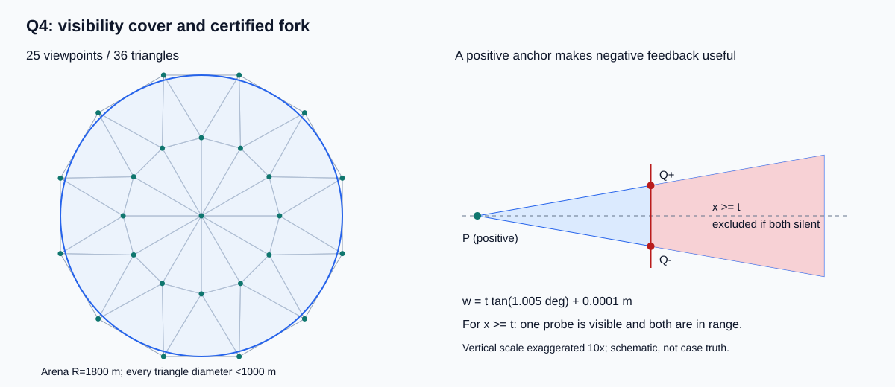

# Q4_BREAKTHROUGH_REPORT

研究分支：`feat/c-q4-research`；隔离工作树：`.worktrees/q4-research`；基线提交：`85916c5`。本轮只做本地研究，未 push、未 merge、未启动任何新的官方演练或正式测试。

## 结论及适用范围

选定并冻结 **Q4_FORK_VIEWS：三角剖分可见性覆盖 + 分叉观测 + 联合路线/共享停点**。独立验证 **128/128 局完成，1660/1660 源清除**；逐局平均 **566.665 s/source**，加权 **551.726**，P95 **809.795**，最差 **913.241**。官方拟用的Python3.12环境复跑同128例：均值 **567.501**，P95 **822.791**，最差 **918.654**，同样全部清除。本轮“稳定平均 <700”在声明的本地验证分布上 **clearly feasible**，且已进入 500–600 平均区间。

这不是所有分布、所有单局都低于700的保证。独立验证的**边界朝外组平均 756.519**；10源组平均 **710.191**，这两个条件平均值仍超过700。官方分布及真实执行结果未知，官方 <700 目前只能评为 **plausible**。不隐藏这些尾部来宣称普遍完成性能目标。

停止条件 A/B 的本地证据已满足：保护候选，进入人工官方演练准备。**READY FOR OFFICIAL Q4 REHEARSAL**。

## 1. 材料核验与复用边界

已读取官方 `input/B题(1).pdf` 全文、附件1/2的本地提取文本、Q1/Q2接口与冻结模型、Q3控制器/环境/evaluator、D策略及几何、HTTP adapter、相关测试、Q3性能拆解和突破报告。检查了主目录及三个既有工作树：未找到已有 Q4 controller、Q4设计文档或Q4实验，报告中不虚构 Q4 历史baseline。

主工作区为干净的 `feat/project-snapshot-20260911`。`q3-breakthrough` 的原 runner/test 有队友未提交修改，本轮未复制覆盖；新 worktree 从其已提交版本建立。冻结的 `FINAL_Q1_Q2/`、`strategies/d/`、`q3/`、原 `simulator.py`、`run.py`、`cases/` 均无改动。

新 `q4/simulator.py` 是独立本地Q4模型：继承原计时/移动/光学clear，只增加规定的定向可见性和显式压力误差场。旧Q3模拟器没有被改成有利于新策略的physics。算法核心仅标准库；Q1/Q2的纯bearing几何语义不变。复用D的保守几何原语和原HTTP adapter，不继承D控制器或Q3排除状态机。

官方核验：1800米圆域；允许场外测点；速度5米/秒；测量5秒；换测向频道1秒；每源唯一频道1–20、总数10–16；接收半径1000–1500米；方向误差±1°、读数0.01°；定向半平面含边界；near需距离≤5米且RF可见；成功clear仅需距离≤20米、固定5秒、不换频道；失败clear3秒。移动中不能有效测量，同位置重复误差固定。

## 2. 第一性原理账本与下界

`T = L/5 + 5M + S + 5N_success + 3N_fail`。必须实际到达源的20米邻域并支付clear固定成本；至少获取能够认证位置的反馈。本队策略每源至少一次正反馈，一次near可以足够，一次direction通常不足以确定径向范围；不声称普遍恰好需要两次测向。

目标是让所有仍相容位置可被一个20米圆覆盖，而非恢复精确坐标。定位和搜索移动可以同时承担访问任务，因此不能把各自理想路线下界直接相加。

离线16例用真值构造 `d_ij=max(0, ||G_i-G_j||-40)`、起点边 `d_0i=max(0,||G_i||-20)`，Held–Karp精确求解放松后的开放路径。圆盘内的入/出点可不同，故这是合法下界而不是一条可执行路线。LB0=路线/5+5N；LB2额外加一次检测5N，限于本队按源观测认证的策略类。真值只在 `experiments/bounds_q4.py` 离线使用。

16例 LB0 范围 **24.970–192.886**，LB2范围 **29.970–197.886 s/source**。聚集源使oracle很低，但真实任务仍须证明其他频道不存在。

固定全朝向搜索的一个弱必要条件：对任意固定法向，每测点覆盖源位置的面积不超过半径1000半圆面积，因此至少需 ceil(2·1800²/1000²)=7个测点。它不是7点充分条件。本文25点路线参考长度 18236.5 米、纯移动 3647.3 秒；20频道全测上界约2999秒固定成本。实际取消已发现频道，且16源达到公开上限时提前结束覆盖。该参考不能标成最短搜索下界，方向带来的额外成本也不是固定的“每源多一次测量”。

700秒预算若按独立验证的固定费用 164.067 秒计，剩余可移动 **2679.7 米/source**；实测移动 **1938.3 米/source**。300/400未被oracle排除，但目前无达到这两个综合均值的证据；500是进一步结构改进目标；500–600已达到；600–700有本地余量；900不应接受为本地平均目标，但仍可能出现在单局尾部。

## 3. Q4专属核心：半平面可见性与25点覆盖

令G为源位置，n为未知辐射法向。定向可见条件 `n·(P−G)≥0`，另需满足未知接收半径。若 `G∈conv(P1,…,Pk)`，每个经过G的闭半平面至少包含一个Pi：否则对所有Pi内积均负，其凸组合G会产生0<0矛盾。反向由严格分离定理成立。

若这些点属于直径<1000米的同一三角形，三角形内每个G到全部顶点均<1000。因此无论朝向如何，至少一个顶点同时满足距离和半平面要求。

使用原点、半径999米的12点环、半径1864米且旋转15°的12点外环，形成36个三角形。最大边长999米；外环内切圆半径 `1864 cos15°≈1800.485740>1800`。这是连续空间和连续方向的覆盖证明，不是枚举若干orientation。外环照顾朝外辐射的边界源。25并未证明为最少点数。



## 4. no_signal何时有用：分叉观测定理

设P是对当前频道的已知正测向点，u为读数方向、v为垂直方向、α=1.005°。真实源在局部坐标为G=P+xu+yv，满足x>0、|y|≤x tanα。α同时保守覆盖±1°误差和0.01°读数舍入；没有放宽clear半径。

选 `Q±=P+t u±w v`，其中t>0、`w>t tanα`，并要求 `w²+2tw tanα<t²`。默认w=t tanα+0.0001米。对任何x≥t的候选真实源：

1. 线段PG在截面x=t上的交点Z属于线段Q−Q+。P可见，G在半平面边界，故Z可见；Q−、Q+至少一个可见。
2. 两点都满足 `||G−Q±||²−||G−P||² = t²+w²−2tx∓2wy ≤ −t²+w²+2tw tanα <0`。已知P在真实接收半径内，所以Q±都不超出同一真实半径，无需读取ρ，也无需用1000替代已知正反馈隐含的距离界。

**因此：若两点都no_signal，则真实源必有x<t。** 可以安全加入半平面x≤t。单点no_signal不产生这个结论；必须核验正anchor、两点位置和range不等式。本轮独立审计逐次验证这些前提。

若任一点direction，加入真实bearing楔形；若near，在该点clear。不是只评价“收到direction”的单分支，也不用独立1/2概率假设。

t通常取当前K沿u投影区间中点。特别处理远处的薄径向切片：若径向宽度小于横向宽度且P仍远，改把截面放到K近端之前。此时所有K满足x≥t，故两点中保证一个正反馈，避免反复负裁剪只缩径向、横向仍大于clear门槛的停滞。

这里证明了命中/负裁剪，不把40轮工程上限冒充经过形式验证的全输入迭代界。正观测形成新的近处anchor并收缩有界楔形；负分支折半投影宽度，薄切片分支保证换anchor。验证集最大实际局部轮数 **6**，所有测试均未耗尽上限。数值异常或预算耗尽显式报incomplete，绝不无证clear。

## 5. 控制器、频道状态与安全clear

每频道保存真实测向、near证据、保守K、覆盖负反馈及清除状态，等价于 UNKNOWN→OBSERVED/TRACKED→CLEAR_READY→CLEARED。结束时的未知频道仅有两种证据：完整25点no_signal；或已经观测到16个不同源，达到公开总数上限。未使用真实源总数。

未访问覆盖点与已知源K中心共同组成路线任务，nearest-neighbor初始化、有限2-opt重排，只执行首项再规划。一个源任务被选中后连续处理至clear，不被cheap SEARCH打断；每个覆盖点只完成一次，源数最多16，单任务有界。不会无限刷新deadline或靠fairness反复往返。路线优化是可解释的启发式，不是TSP全局最优。

扫描停点补测仍可能可见的已知频道；清除停点对区域仍大、全部K距当前点≤1000、且与旧样点分开至少25米的频道顺手测量。该距离只用于机会测量筛选，**不声称定向源一定接收**；单次no_signal保留历史。多频道不能同时测，只共享移动停点，各次5秒和切频道1秒全部计入。

clear安全层与路线层分离：near⇒距源≤5米；否则K为场域外包∩实际测向楔形∩1500米接收圆外包∩经定理认证的fork负半平面。圆使用48条外切支持线，各线向外放宽1e−6米。所有真实相容位置均在K中。取覆盖K全部顶点的圆，再验最大顶点距离，只有R≤20−1e−4米才clear。凸性保证覆盖整个K，不能用直径≤40、点估计或概率代替。

K是Q4物理外包，不是冻结Q1纯bearing交会区域Ω。Q1代码及其语义没有更改。无需分类OMNI/DIRECTIONAL；显式方向belief、粒子/MPC没有进入最终实现，避免无必要复杂度。

## 6. 实跑架构探索与消融

所有行使用同一48例development、622源；全部清除。前五项先在24例探索，随后固定方法补齐48例对照；未用validation继续选择或调整参数。

|方案|清除|mean|weighted|median|P75|P95|worst|
|---|---|---|---|---|---|---|---|
|Q4_BATCH|622/622|777.433|758.576|773.524|880.394|1107.126|1293.828|
|Q4_IMMEDIATE|622/622|762.789|746.230|749.486|891.328|1053.723|1242.977|
|Q4_JOINT|622/622|739.772|723.680|720.213|828.820|978.810|1260.849|
|Q4_JOINT_VIEWS|622/622|652.353|635.194|625.583|762.806|947.640|1262.449|
|Q4_PURSUIT|622/622|602.342|584.305|602.194|694.679|861.409|900.344|
|Q4_FORK_BATCH|622/622|665.145|647.542|705.875|752.074|881.006|932.496|
|Q4_FORK_JOINT|622/622|621.724|606.574|625.614|701.041|804.331|901.572|
|Q4_FORK_VIEWS|622/622|568.649|552.125|571.526|658.902|775.677|903.172|

- BATCH：完整搜索后清理，串行重复路线与大尺度重捕获，淘汰。
- IMMEDIATE：每个扫描点后清完已知源，破坏后续共享观测、绕行多，淘汰。
- JOINT：仅改变访问顺序仍保留昂贵重捕获，未达平均700。
- JOINT_VIEWS：共享观测降低平均，但最差仍1262，尾部不合格。
- PURSUIT：前4轮短步追踪，之后网格/中心接管；安全但重捕获分支成本较高。
- FORK_BATCH / FORK_JOINT：分叉定理独立改善局部问题，但仍分别损失联合路线/共享观测。
- FORK_VIEWS：最终候选。相对普通Q4_BATCH加权改善约27%；相对同样共享视点的网格版改善约13%；相对PURSUIT改善约5.5%，同时P95更好，并有更直接的负反馈证明，因此保留。没有围绕一个900秒弱baseline做碎参数扫描。

未实现的方向：orientation particles、概率MPC、beam search、连续全局最优。它们是可选未来研究，不包装成已测试失败方案。

## 7. 固定、开发、独立验证与压力结果

单位s/source；mean/median/P75/P95/worst按每局T/N统计，P分位线性插值；weighted=ΣT/ΣN。只有P0全部通过的案例参与时间排名，失败局没有用部分清除分母伪装快。

|数据|清除|mean|weighted|median|P75|P95|worst|
|---|---|---|---|---|---|---|---|
|固定Q4派生20|249/249|563.852|541.608|591.342|675.103|731.109|790.077|
|旧固定全向20|249/249|492.082|467.356|504.911|631.135|664.654|670.256|
|开发48|622/622|568.649|552.125|571.526|658.902|775.677|903.172|
|独立验证128 / Python3.9|1660/1660|566.665|551.726|562.991|648.006|809.795|913.241|
|同验证128 / Python3.12|1660/1660|567.501|552.108|561.454|657.485|822.791|918.654|
|压力64 / positive|829/829|586.546|571.508|579.820|693.652|793.230|922.116|
|压力64 / negative|829/829|583.735|568.221|559.418|694.155|812.187|911.472|
|压力64 / checker|829/829|587.220|572.109|562.847|693.427|793.087|898.764|
|压力64 / smooth|829/829|583.157|568.527|569.181|683.584|797.278|895.826|

固定Q4是对原20案例位置/半径/频道保持不变、在新目录增加确定的类型/朝向；不是官方Q4测试，也不是独立validation。原cases完全未改，另实跑全向回归。

原D_JOINT_VIEWS不改代码直接用于同20个Q4派生案例：67/249清除，19局因接收保证冲突停止，另1局正常退出却漏5源；P0完成0/20。它不是合法Q4性能基线，只作为“不能直接搬”的反例。Q4_BATCH才是本轮有完整安全与搜索机制的主性能对照。

随机开发seed起点491700，验证830100，压力290900；误差seed单独加1000000；策略确定性，不读任何seed。验证128个布局按8类均分；压力64个独立布局全部半径1000，分别重复+1°、−1°、23米棋盘±1°、平滑正弦固定空间误差。重复同一点误差固定，四种场不是256个独立布局。全向/全定向组是边界压力扩展，不冒充官方“混合”案例。

候选hash在validation前保存在q4_candidate_freeze.json；验证runner拒绝hash漂移、失败时返回异常。冻结后仅完善离线工具、报告和runner，未调控制器参数。原型开发和主验证用本地Python3.9.7（额外兼容性）；用于官方的项目Python3.12复跑128例全部完成。跨版本并非逐轨迹一致：case_000首次差异在第45个动作，两版本在几乎等距的对称环点中选择了不同方向；后续反馈也不同。未为消除这类数值平局而改冻结策略。两版本均值相差不到1秒/source，均保留原始轨迹和精确环境。代码通过Python3.10语法检查，运行核心没有新第三方依赖。

### 独立验证分布与尾部

|分布|清除|mean|P95|worst|
|---|---|---|---|---|
|all_directional|206/206|576.492|771.308|833.539|
|center|212/212|511.157|692.237|707.189|
|cluster|207/207|470.367|614.333|637.229|
|dispersed|209/209|575.920|715.675|753.836|
|edge_outward|210/210|756.519|887.149|913.241|
|omni_majority|208/208|503.831|657.765|706.225|
|tangent|204/204|573.908|697.604|830.117|
|uniform_mixed|204/204|565.124|709.762|719.866|

|源数|案例数|mean|
|---|---|---|
|10|19|710.191|
|11|18|660.396|
|12|19|602.273|
|13|18|573.847|
|14|18|511.549|
|15|18|505.011|
|16|18|393.435|

边界朝外组是主要尾部：内环几乎看不到这些源，外环首次发现后还要接近；未知频道仍需完整覆盖。10源时固定搜索开销分摊少，16源则能利用公开上限提前结束搜索。因此总体均值不代表每个源数组或每种方向布局的均值都<700。

### 固定Q4逐案例

|case|清除|总虚拟秒|秒/source|移动米|measure|switch|
|---|---|---|---|---|---|---|
|case_000.json|10/10|6712.364|671.236|22801.819|353|337|
|case_001.json|10/10|7900.767|790.077|27528.833|396|365|
|case_002.json|12/12|6282.495|523.541|21907.475|311|286|
|case_003.json|15/15|7434.103|495.607|25995.516|365|335|
|case_004.json|12/12|7291.966|607.664|25554.830|358|331|
|case_005.json|15/15|6709.403|447.294|23267.013|335|306|
|case_006.json|16/16|1714.663|107.166|5768.317|82|71|
|case_007.json|13/13|7621.578|586.275|26922.892|370|322|
|case_008.json|10/10|6896.348|689.635|23641.742|357|333|
|case_009.json|16/16|7232.935|452.058|27269.676|291|244|
|case_010.json|10/10|5964.078|596.408|20120.389|317|305|
|case_011.json|12/12|7203.503|600.292|25122.513|358|329|
|case_012.json|10/10|7280.055|728.005|24855.275|382|349|
|case_013.json|15/15|8118.202|541.213|28761.012|389|346|
|case_014.json|13/13|5985.125|460.394|21960.627|258|238|
|case_015.json|10/10|7207.199|720.720|23575.994|411|387|
|case_016.json|16/16|6177.603|386.100|22318.015|277|249|
|case_017.json|13/13|7399.688|569.207|26193.440|355|321|
|case_018.json|10/10|6174.479|617.448|21257.394|314|303|
|case_019.json|11/11|7553.743|686.704|25903.715|391|363|

## 8. 时间成本与现实计算

独立验证总虚拟时间 **915865.886 秒**，移动 **3217574.428 米**，measure **44765** 次，switch **40226** 次，成功clear **1660** 次。

|物理费用|秒/source|说明|
|---|---|---|
|movement|387.660|实际欧氏移动/5|
|measure固定|134.834|每次5秒|
|switch|24.233|仅measure频道变化|
|clear固定|5.000|每源一次成功clear|
|合计|551.726|无隐含并行折扣|

|阶段（含该动作到达移动）|秒/source|
|---|---|
|search|383.145|
|localization|125.069|
|reacquisition|7.602|
|shared_view|2.469|
|clear|33.442|
|fallback|0.000|

阶段费用与物理费用是同一账本的两种切分，不能相加。fork首测计localization；首测无信号后的第二分叉探测计reacquisition，因此最终重捕获费用虽小并非没有方向性处理。clear阶段包含到证书点的移动；clear固定动作仍恰好5秒/source。fallback为0，没有把失败时间藏在未分类项。

主要剩余成本：①完整性搜索（约383秒/source）；②源接近和定位（约125秒/source）；③证书清除点的到达移动（clear阶段扣5秒）。物理必需的是观测、覆盖足够方向、到达20米邻域及固定动作；25点逐频道扫描、稀疏源的空频道成本和部分回访属于可继续改进的架构开销。继续研究的明确方向是缩短带证明的搜索/排除义务，预计比调fork步长更有价值；本轮不为几十秒冒险重写已验证候选。

完整逐局每项总量、阶段费用、mean/median/P75/P95/worst保存在summary JSON。运行时间使用同一Python3.12进程、交替方案顺序、8类开发案例，1轮warmup+4轮计时；不含HTTP/磁盘：

|方案|mean wall秒/局|median|P95|worst|
|---|---|---|---|---|
|Q4_BATCH|0.026|0.024|0.037|0.039|
|Q4_PURSUIT|0.033|0.032|0.048|0.054|
|Q4_FORK_VIEWS|0.033|0.032|0.048|0.048|

虚拟成绩不受现实计算速度折扣；官方HTTP与日志I/O时间未知。原HTTP依赖已固定requests==2.34.2，新策略无需NumPy/SciPy，所以不触发旧Q2的版本兼容问题。

## 9. 安全审计与验证证据

全部候选统计集合（开发48、验证128、固定Q4 20、全向回归20、四场压力256，另加Python3.12同验证集复跑128）共 **600 次运行 / 7756 源次**。复跑与误差场重复不是新的独立布局：

- 真实源清除率100%，missed source=0，false exclusion=0。
- uncertified clear=0，failed clear=0，contract error=0，truth outside enclosure=0，账本重算误差超限=0。
- 独立50位Decimal重放 **220138 动作、7756 clear、6712 fork负裁剪**，全部通过。重放从API与可检查的fork见证重建区域，不采用控制器声称的polygon或半径；见证必须与真实相邻两次no_signal和既有positive anchor一致。
- 离线truth containment是额外验证，真值不进入运行策略。AST检查运行控制器对api只调用measure/clear；观察接口只暴露两个callable。这是代码审计与接口纪律，不声称能抵御恶意Python反射。
- 实跑 `python -m unittest -v`：22通过；`python -m unittest discover -s tests -v`：74通过。共96项，包含原HTTP adapter测试、Q4方向/near/光学边界、fork不等式/薄片、拒绝坏反馈、独立replay和官方runner无隐式网络/未知结果停止。
- 冻结文件diff及candidate hash一致；未写入任何官方加密日志。

数值边界：几何证明基于精确实数，运行使用float外扩与clear安全余量，审计用50位交点；三角函数仍由libm给出，**不是完整区间算术形式验证**。保留有限40轮fail-closed上限，对损坏反馈、超时和未知HTTP结果不会假报完成。大样本全清不是全输入数学正确性的替代。

## 10. 官方预期、人工启动与交接

没有本轮官方成绩；不把离线结果叫官方演练。若官方分布与独立验证接近，可用拟用Python3.12的本地均值约568、P95约823作为演练前估计；偏重稀疏边界朝外源时可能接近或超过900，不能承诺官方平均<700。下一项必要证据是人工启动一次Q4演练，核对官方显示的源总数及实际清除比例。

**READY FOR OFFICIAL Q4 REHEARSAL**。由用户打开官方模拟器、点击“问题4演练测试”、等待“等待机器狗进入”，然后在PowerShell执行：

```powershell
Set-Location -LiteralPath 'C:\Users\CuO\Documents\ChatGPT\国赛\.worktrees\q4-research'
$env:CUMCM_ROBOT_ID = Read-Host '输入当前登录的参赛队号'
& 'C:\Users\CuO\Documents\ChatGPT\国赛\.venv\Scripts\python.exe' -X utf8 '.\run_q4_official.py' --exercise
```

runner无--exercise、无ID或候选hash不符时不会发HTTP。它不操作官方GUI或选择测试模块；HTTP协议本身不返回演练/正式模式，必须由人选择正确的Q4演练入口。沿用串行adapter与同request_id重试，按/enter公开剩余时间控制期限，未知动作结果停止且不盲发/exit。只有已证完成才正常exit。首次官方成功前不建议用于正式测试，本轮没有代为启动任何测试。

演练本地日志位于results/q4_official_rehearsal/<timestamp>/，官方源总数不从接口返回，summary中保持null而不是猜值；人工把演练结束界面的总数与日志清除数对照。保留原官方加密日志及文件名，不修改。

### 产物与复现

- 最佳代码：q4/controller.py、q4/geometry.py；本地规则fixture：q4/simulator.py。
- 实验：experiments/run_q4.py；冻结validation：experiments/validate_q4.py。
- 一键本地复现：`powershell -ExecutionPolicy Bypass -File .\experiments\reproduce_q4.ps1`。脚本不调用官方runner。
- 原始轨迹：被忽略的results/q4_*；新固定/随机案例：被忽略的cases_extra/q4/，有不可覆盖生成器、分离seed、逐case SHA256。
- 可复核汇总：experiments/q4_ablation.json、q4_validation.json、q4_fixed.json、q4_stress_*.json、q4_oracle_bounds.json、q4_runtime.json。
- 审计：Q4_SAFETY_AUDIT.md、experiments/q4_safety_audit.json、q4_verification.json、q4_candidate_freeze.json。
- 官方准备入口：run_q4_official.py，只有人工命令才联网。

未完成：真实官方Q4验收；每种分布平均<700；最短全朝向搜索路线；完整浮点区间证明及40轮全输入上限证明。没有push、merge或自动正式测试。
